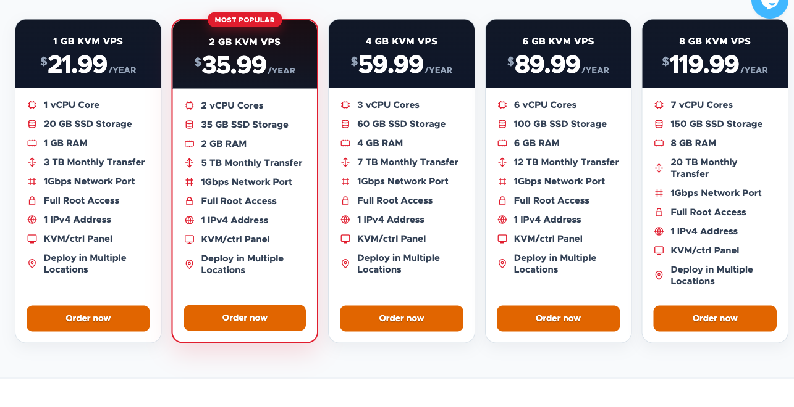
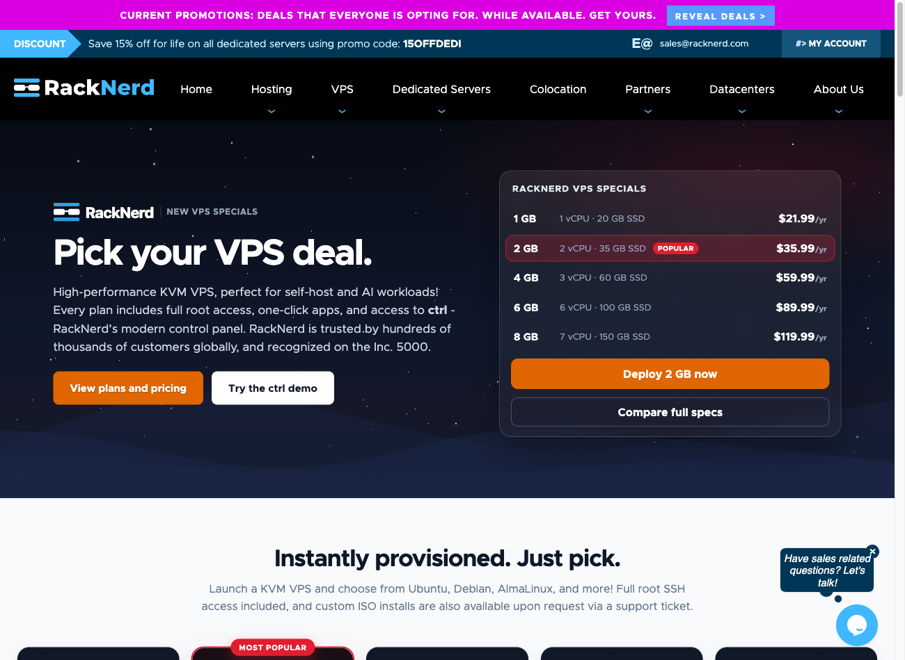
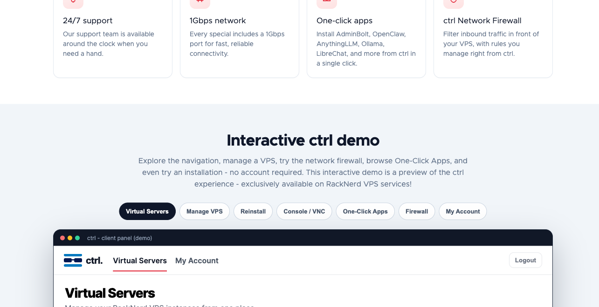
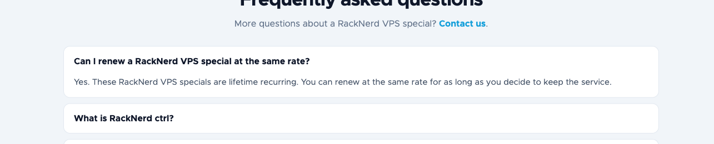

# RackNerd Review 2026: Cheap Annual VPS from $21.99/Year

RackNerd is a practical alternative to hourly cloud platforms when you want one small server to stay online for a full year without turning billing into another project. Its current VPS specials start at **$21.99 per year**, with KVM virtualization, root access, an IPv4 address and multiple deployment locations.

[See the current RackNerd VPS specials](https://my.racknerd.com/aff.php?aff=21833)

## Quick verdict

**Choose RackNerd when annual cost matters more than hourly flexibility.** It fits personal sites, monitoring, bots, small Docker services, development environments and other rebuildable workloads.

The entry plans are easy to position:

- **1 GB at $21.99/year** for a static site, monitoring or a Linux lab;
- **2 GB at $35.99/year** for WordPress, small containers or several background services;
- **4 GB at $59.99/year** for a more comfortable multi-service setup;
- larger 6 GB and 8 GB options for workloads that need more memory.

## RackNerd vs DigitalOcean, Vultr and Linode

DigitalOcean, Vultr and Linode are cloud platforms built around rapid deployment, hourly billing, APIs and adjacent services. RackNerd is a simpler purchase: pay for a year and keep a VPS running.

| Buying priority | Better fit |
|---|---|
| Hourly billing and frequent server replacement | DigitalOcean / Vultr / Linode-style cloud |
| Low total cost for a server kept all year | RackNerd annual VPS |
| Managed databases and a broad cloud ecosystem | Full cloud platform |
| Website, bot, monitor, VPN endpoint or Linux lab | RackNerd |

That distinction is the main reason to consider RackNerd. You are not paying for an oversized cloud ecosystem when the workload only needs a conventional VPS.

## Which RackNerd plan should you buy?

### 1 GB KVM VPS — the budget starting point

The $21.99/year plan lists 1 vCPU, 1 GB RAM, 20 GB SSD storage and 3 TB monthly transfer. It is a sensible start for Nginx, a static site, uptime monitoring, a small bot or command-line development tools.

### 2 GB KVM VPS — the balanced option

The $35.99/year plan lists 2 vCPU, 2 GB RAM, 35 GB SSD storage and 5 TB monthly transfer. This is the better default for WordPress, a lightweight database, a small Docker stack or multiple services.

### 4 GB and above — more room for combined workloads

The larger plans provide additional memory, CPU allocation, storage and transfer. Buy them for an identified workload, not merely because the annual price looks inexpensive.

[Compare RackNerd annual VPS plans](https://my.racknerd.com/aff.php?aff=21833)

## Locations and server management

RackNerd lists multiple deployment locations. Pick a location close to the users or services that will actually connect to the VPS rather than choosing a region by brand familiarity alone.

The control panel is designed for standard self-managed VPS work: reinstalling the operating system, opening a console, managing the virtual server and configuring firewall-related settings.

For a first deployment, Ubuntu or Debian keeps the setup straightforward. Update the system, create a non-root administrator, configure SSH keys and a firewall, then install the application stack.

## Does the special renew at the same price?

RackNerd's specials-page FAQ states that these VPS specials are recurring and can renew at the same rate while the service is retained. That makes the offer easier to evaluate as an ongoing annual cost rather than a one-time teaser.

## Who should choose RackNerd?

RackNerd is a good match if you:

- want a low-cost VPS that stays online all year;
- can administer Linux and maintain your own backups;
- need root access, KVM and a dedicated IPv4 address;
- run a personal site, monitor, bot, small API or development environment.

A managed hosting plan is a better fit if you do not want to maintain the operating system. An hourly cloud is a better fit if the server will exist for only a few days or must be created and destroyed repeatedly.

## Final recommendation

Start with 1 GB for a static site, monitoring or a Linux lab. Pick 2 GB for WordPress, containers or a small database-backed application. The most compelling part of RackNerd is not a monthly-equivalent headline—it is the clearly defined **full-year price**.

[Check RackNerd VPS availability and locations](https://my.racknerd.com/aff.php?aff=21833)

## FAQ

### Is RackNerd billed monthly?

The offers covered here are annual specials, so the full yearly amount is paid for the billing period.

### Can RackNerd host WordPress?

Yes. The 2 GB tier is a more comfortable starting point for WordPress than the entry 1 GB plan, especially when a database and control panel are installed.

### Is 1 GB RAM enough for a VPS?

It is enough for many static sites, monitors, small bots and Linux labs. Choose 2 GB or more for multiple containers, WordPress or memory-sensitive applications.

### Is RackNerd managed hosting?

These are self-managed VPS plans. You are responsible for the operating system, application deployment, updates and backups.
